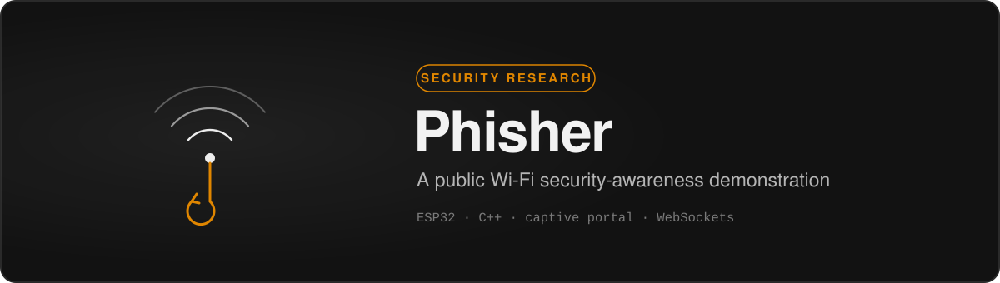
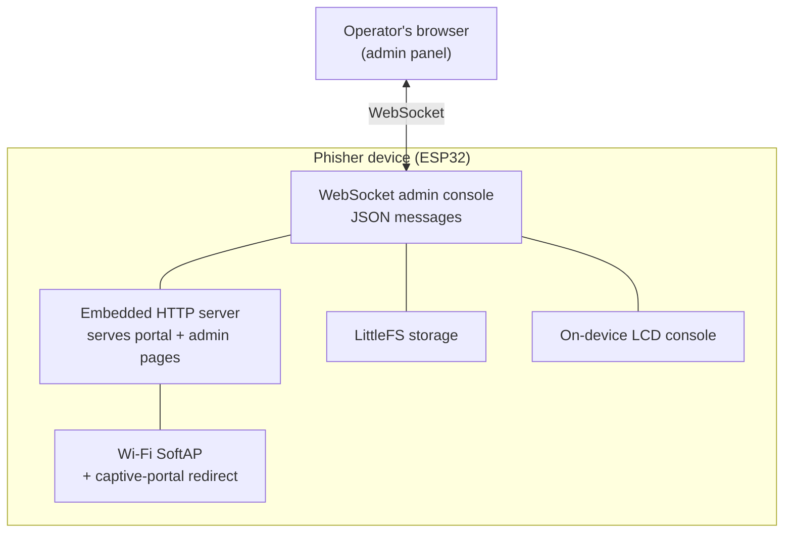

## Phisher

Phisher is a security-awareness project built on a small ESP32 board. It was made for conference talks about the risks of connecting to untrusted public Wi-Fi: coffee-shop, airport, and hotel networks where anyone nearby can stand up a network that looks just as legitimate as the real one.

The point of the project is defensive. It exists to show an audience, in a concrete way, why "free Wi-Fi" should be treated as hostile by default, and to send people home knowing what to do about it. This repository is the companion to those talks, not a how-to.

## The risk it demonstrates

On an open wireless network there is nothing that proves the network is who it claims to be. Your device trusts the name. That makes two things easy for whoever controls the access point:

A device can broadcast a familiar-looking network name, and phones and laptops will happily show it next to the real one. Once you are connected, the network can redirect your browser to a page it controls, the same way the "sign in to continue" screens on real public Wi-Fi work. A page like that can be made to look convincing, and anything typed into it goes to whoever set it up.

None of this requires expensive or exotic hardware, which is exactly the uncomfortable part, and the reason the demo lands with audiences. Phisher makes that abstract risk visible on stage so people stop treating open Wi-Fi as harmless.

## Architecture

The structural side, for anyone curious about how it is put together. This is a tour of the stack, not a build guide.

| Layer            | What it uses                                                        |
| :--------------- | :------------------------------------------------------------------ |
| Board            | ESP32 microcontroller, runs entirely on-device                      |
| Language         | C / C++ on the Arduino framework                                    |
| Networking       | Wi-Fi SoftAP with a captive-portal redirect                         |
| Web layer        | Embedded HTTP server serving pages stored as compiled-in headers    |
| Control channel  | A WebSocket admin console that exchanges JSON messages              |
| Storage          | LittleFS on the ESP32's flash                                       |
| On-device UI     | A small LCD console that mirrors status and logs                    |

The codebase is organized into a few modules: the captive portal, the embedded HTML pages, a console/logging module mirrored to the LCD, a shared global-state module, and the main sketch that ties them together. Everything runs standalone on the microcontroller with no external server.

## Talks

Phisher has been presented as a live demonstration at several cybersecurity conferences, used to show an audience how little it takes to impersonate a public network and why that matters for everyday users.

- DEFCON902, Halifax, Nova Scotia, 2024
- ATLSECCON 2025, Halifax, Nova Scotia ([recording](https://www.youtube.com/watch?v=MCNPLVsqKd4))

## How to stay safe on public Wi-Fi

This is the part worth sharing with everyone, and the actual takeaway of the talk.

- Treat any open or public network as untrusted. Assume someone could be watching or interfering.
- Use a VPN on public Wi-Fi, or skip it entirely and use your phone's cellular data or a personal hotspot for anything sensitive.
- Be suspicious of "sign-in" pages that ask for an email password, social login, or payment details just to get online. Real captive portals rarely need those.
- Check for HTTPS and a valid certificate before entering anything, and never dismiss a certificate warning on public Wi-Fi.
- Turn off auto-join for open networks, and forget networks you no longer use so your devices stop reconnecting on their own.
- Prefer passkeys or multi-factor authentication, so a stolen password alone is not enough.
- Keep your phone, laptop, and browser updated.

## Responsible use

This project is for education and authorized security research only. Demonstrate it on your own equipment, in a controlled environment, or where you have explicit written permission. Impersonating networks, intercepting traffic, or collecting other people's information without consent is illegal in most jurisdictions. The goal here is to help people defend themselves, nothing more.

## Built with

- [ESP32](https://www.espressif.com/en/products/socs/esp32) (Espressif)
- C / C++ on the [Arduino](https://www.arduino.cc/) framework
- WebSockets and LittleFS

Security-research project by [Leonardo Lees](https://github.com/LeoL6).
